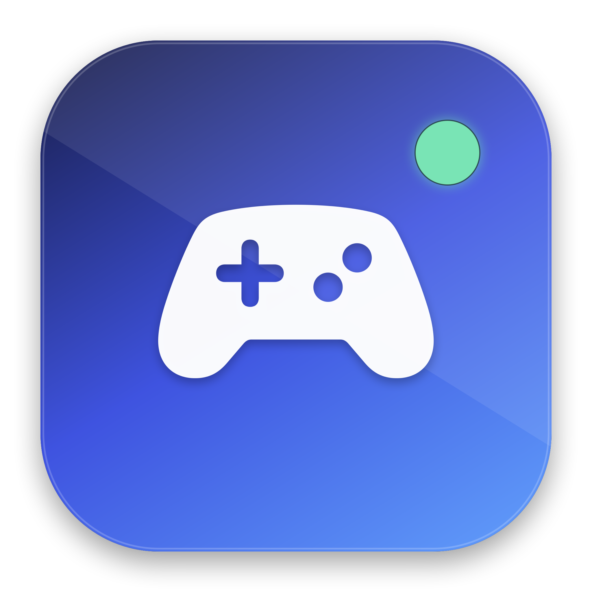

<p align="center">
  
</p>

<h1 align="center">SwiftNX</h1>

<p align="center">
  A native SwiftUI macOS frontend for <a href="https://github.com/seedds/nxnative">nxnative</a>.<br>
  Turn your own Switch game dumps into self-contained Mac apps without typing the build pipeline by hand.
</p>

---

SwiftNX wraps the complete macOS flow from the [nxnative guide](https://github.com/seedds/nxnative) in a native macOS app:

- **Environment check** — Xcode, the Metal Toolchain, .NET 10, Homebrew, zstd, glslang, git, a SwiftNX-managed Python environment, the nxnative checkout, `prod.keys` and free disk space.
- **3-step port wizard** — pick the base game and matching update, review the detected title ID against nxnative's game profiles, set the app name/language/paths, then start.
- **Live build monitor** — reads nxnative's `--progress json` stream: stages, steps, counts, ETA, full log, cancel/retry.
- **Game library** — the finished `.app` is added automatically with its icon, version and title ID; play, reveal or remove it from the library.
- **Built-in maintenance** — one-click tool installation, isolated Python environment, Metal Toolchain download, and fast-forward-only nxnative updates.

SwiftNX does **not** include games or keys. You need your own dumps and your own `prod.keys`.

## Features

| Area | What SwiftNX does |
|---|---|
| Setup | Checks the exact tools nxnative needs; installs Homebrew formulae and creates its own Python venv in `~/Library/Application Support/SwiftNX`. |
| Game files | Reads PFS0/NSP content-meta names and filename tags to detect the title ID, update version and supported profile without decrypting anything. |
| Wizard | Base game + update + optional DLC, app name, language, working/output folders, signing identity. |
| Build | Runs `build_ipa_from_nsp.py --platform mac-app --progress json` in a staged folder and turns the JSON events into a native progress view. |
| Library | Persists built apps in `library.json`, reads their Info.plist for the final name/version/title ID. |
| Updates | Shows branch, commit, dirty state and ahead/behind; pulls upstream only with `--ff-only`, never touching SwiftNX settings. |
| Safety | No sudo is ever run by SwiftNX. Steps that need a password are opened in Terminal for you. Keys never leave the Mac. |

## Requirements

To **run SwiftNX**: macOS 14 or later.

To **port a game**, the nxnative requirements apply:

- Apple silicon Mac (M1 or newer). Intel Macs cannot run nxnative's Mac host.
- macOS that runs Xcode 27.1 (the current nxnative recommends macOS 26.6+).
- Xcode with the **Metal Toolchain** installed.
- .NET 10 runtime, Homebrew, `git`, `zstd`, `glslang`.
- Python 3.12+; SwiftNX creates and manages Python 3.14 through `uv`.
- Your own base game, the matching update, optional DLC, and your own `prod.keys`.
- About twice the game size plus 10 GB free disk space. The first build can take 30–60 minutes.

## Build SwiftNX

```sh
make app
open dist/SwiftNX.app
```

or:

```sh
./Scripts/build-app.sh
open dist/SwiftNX.app
```

The app is ad-hoc signed, like nxnative's own locally built apps. The build script also works when only the Command Line Tools are selected; it loads the SwiftUI macro plugin from Xcode when the CLT SDK does not provide it. Using full Xcode is still recommended.

The app icon is generated from code:

```sh
swift Scripts/make-icon.swift Resources
```

## First run

1. Open SwiftNX. The welcome screen offers **Set Up My Mac**, which opens **Environment**.
2. Run **Check Again**. Missing Homebrew formulae and the Python environment can be installed with **Set Up Everything**.
3. Accept the Xcode license once (the button opens a Terminal command). Install the Metal Toolchain from the Environment screen if needed.
4. Install the .NET SDK if it is missing (button opens a Terminal with `brew install --cask dotnet-sdk`).
5. Choose your `prod.keys` and confirm the nxnative checkout path.
6. Click **Port a Game**, choose the base file and update, review the detected profile, and start the build.

The build runs in nxnative's own working folder. The resulting app is written to the output folder (default `~/Applications/SwiftNX`) and added to the library.

## How it maps to the guide

SwiftNX uses the current nxnative command instead of the older AppleGamingWiki steps:

```sh
cd ~/nxnative
/Users/you/Library/Application\ Support/SwiftNX/venv/bin/python3 \
  scripts/build_ipa_from_nsp.py \
  "/Users/you/Games/SwiftNX/Game [010015100B514000]" \
  -k "/Users/you/keys/prod.keys" \
  --platform mac-app \
  --progress json \
  -l en-US \
  -o "/Users/you/Applications/SwiftNX/Game.app" \
  --app-name "Game"
```

- `--platform mac-app` builds the Mac host, Metal shaders and the complete self-contained app (the current nxnative path; it replaces the manual Step 9 packaging from the older guide).
- SwiftNX creates a working folder with symlinks to the selected files. nxnative keeps its `<titleID>_build` cache there, so later builds reuse extraction, rewritten modules and shader work.
- The tool's progress stream is documented in nxnative's `docs/development.md`; SwiftNX parses the `stage`, `step`, `progress`, `stage_end` and `say` events.

## Project layout

```
Sources/SwiftNXKit/        Testable core: title IDs, PFS0 inspection, profiles, build events
Sources/SwiftNX/Models/     Settings, environment checks, port plan, library, app model
Sources/SwiftNX/Services/   Process streaming, toolchain setup, build runner, updater
Sources/SwiftNX/Views/      SwiftUI interface
Tests/SwiftNXKitTests/      XCTest coverage for parsing and profile logic
Scripts/                    App bundle + icon generation
Resources/                  Info.plist and app icon
```

Data written by SwiftNX:

```
~/Library/Application Support/SwiftNX/
  library.json             built apps
  venv/                    isolated Python 3.14 environment
  Logs/                    full build and setup logs
~/Games/SwiftNX/           default working/staging root
~/Applications/SwiftNX/    default output folder
```

## Development

```sh
swift build
swift test        # needs full Xcode for XCTest
./Scripts/build-app.sh --debug
```

The `SwiftNXKit` target has no SwiftUI dependency, so its parsing logic can be checked quickly. If `swift test` reports that `XCTest` cannot be resolved, select Xcode with `sudo xcode-select -s /Applications/Xcode.app` and accept its license.

## Troubleshooting

| Symptom | Fix |
|---|---|
| `SwiftUIMacros` plugin not found while building | `./Scripts/build-app.sh` handles this for CLT-only setups. Or select Xcode. |
| Metal compiler is missing | Environment → **Install toolchain**, or `xcodebuild -downloadComponent MetalToolchain`. |
| Xcode license error | Environment → **Accept license**, or `/usr/bin/sudo /usr/bin/xcodebuild -license accept`. |
| .NET 10 not found | Environment → **Install .NET**, or `brew install --cask dotnet-sdk`. |
| “No checked-in game profile” | nxnative will survey the game and build provisionally. Check the game's version in nxnative's supported list first. |
| Staging folder already has a real file with that name | Choose another working folder; SwiftNX refuses to overwrite real files. |
| Build log ends in a red step | Open **Show full log**; nxnative writes one log per build step under `<titleID>_build/logs/`. |
| Update fails in **Updates** | The checkout has local changes. SwiftNX uses `git pull --ff-only` and shows the state instead of forcing anything. |

## Credits & legal

- [nxnative](https://github.com/seedds/nxnative) is the porting engine (MIT). SwiftNX is an independent frontend.
- SwiftNX does not contain, download or distribute game data, keys or Nintendo code.
- Nintendo Switch is a trademark of Nintendo. This project is not affiliated with or endorsed by Nintendo.
- Build only games you own, using keys and dumps from your own console.
